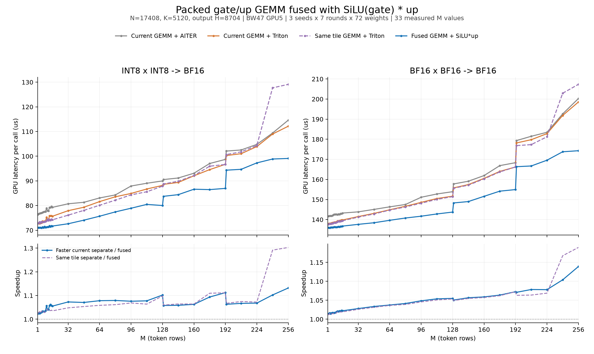

# Fused gate/up GEMM checkpoint — 2026-11-15

保存 gfx936 特殊布局融合版：INT8 / BF16 输入，直接输出 BF16 [M,8704]；固定 K=5120、合并 N=17408、M=1..256。
W 静态准备为 G16/U16 交错，N16 内保留 PI16；保留 GEMM 的 BF16 舍入点，在寄存器内完成 SiLU(gate)*up。

## 内容

- `fused-gate-up-release.tar.gz`：完整、自包含成果包，含运行时、生成器、64 个模块 / 68 个函数配置、冻结基线、复现脚本及原始记录。
- `sources/`：逐字节复制的可审阅源码。运行时使用解包后的完整目录，以具备 kernels 和基线依赖。
- `evidence/REPORT.md`：完整方法、数值边界和性能报告。
- `evidence/RESULT.json`、CSV、图表：聚合结果。
- `evidence/validation.json`、`evidence/benchmark-raw.json`：全 M 验证和正式计时样本。
- `SNAPSHOT.json`：原始位置、文件校验与验证元数据。

## 已验证结果

两种输入各两个 seed，逐 M 覆盖 1..256，共 1024 组；所选配置融合前 gate/up 与原版逐位一致。另有98组整数/边界检查和68组逐 family 随机检查。gate>=-80 区域相对独立激活最多1个BF16 ULP；更负gate的额外差异绝对值小于2.3e-34，详见报告。
BW47 / zhuwenbo_sgl_0522 / GPU5，三组独立数据 × 七轮 × 72份W，33个实际M测点。包含A在线重排，排除静态W准备和INT8输入量化；对照取原GEMM+AITER/Triton中更快者。

| 输入 | 延迟减少范围 | M256 分离 / us | M256 融合 / us |
|---|---:|---:|---:|
| INT8 | 2.3%–11.6% | 112.160 | 99.098 |
| BF16 | 1.4%–12.2% | 198.531 | 174.291 |

三组数据各自33点均更快；同tile分离对照也保留在报告中。以上为Graph内GPU算子路径时间。



## 解包与使用

```bash
sha256sum -c fused-gate-up-release.tar.gz.sha256
tar -xzf fused-gate-up-release.tar.gz
cd fused-gate-up
```

```python
from fused_gemm import prepare_weight, silu_mul
p16 = prepare_weight(w16)
y16 = silu_mul(x16, p16)
p8 = prepare_weight(w8, scale_b=sw)
y8 = silu_mul(xq, p8, scale_a=sx)
```

W为[5120,17408]、stride=(1,5120)，X为连续[M,5120]；sx为FP32[M,1]，sw为FP32[17408,1]。W/sw修改后重新prepare。
完整复现步骤见解包后的 README.md / REPORT.md。Torch 2.11.0、HIP 7.2.26365、gfx936；测试脚本固定物理GPU5，运行时继承调用方映射。当前不支持任意N/K、bias、clipping或autograd，是独立实验入口。

原始成果目录：`/home/metic/gate-up-fused-20261115-122610/`。
完整包 SHA256：`00a3fa0b879192a8f584e841f4bfedfc35ce85d31a34a186a24f1179a8dbc59a`。
