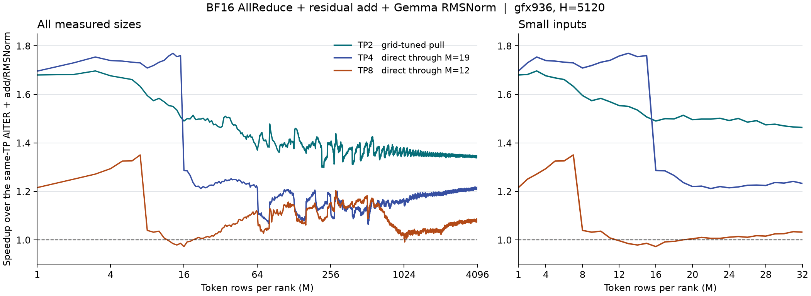

# AllReduce + residual add + Gemma RMSNorm（gfx936）

单机 TP2、TP4、TP8 的 HIP 实现。每个 rank 输入连续 BF16 张量 `x[M, 5120]`、本地残差 `residual[M, 5120]` 和 Gemma 权重 `weight[5120]`。一次 kernel 调用返回归一化输出和更新后的残差，两者均为 BF16。权重沿用 Gemma 的 `1 + weight` 约定。

TP2 另有显式的 `fused_int8()` 入口，返回 INT8 激活、FP32 per-token scale 和 BF16 residual。选择 INT8 入口后默认使用逐比特模式，也可传入 `fast=True` 选择 FP32 单轮归约。[TP2 双卡调用示例](tp2/README.md)

## 对 AITER 两段的实测

基线在相同 TP、相同 M 下先执行 AITER IPC AllReduce（含输入拷贝），再执行 SGLang 的 residual add + Gemma RMSNorm。输入预先就位，计时覆盖算子 Graph。每轮在 Graph 内连续调用 8 次，取同轮最慢 rank 的每次耗时，再取 9 轮中位数。三组实验使用 Qwen3.6-27B 的真实归一化权重、epsilon 为 `1e-6`。核心频率为 1500 MHz，HBM 为 1800 MHz。

实测环境使用 SGLang 0.5.22、PyTorch `2.11.0+dtk2610.2611031312.g529def`、AITER `0.1.8+dtk2610.torch2110.2611031115.ga1a2bc` 与 Triton `3.6.0+dtk2610.torch2110.2611031429.g92771c`。原始多卡 AITER 动态库的 SHA-256 和各自内核源码校验值见 [TP4](tp4/results/provenance.json) 和 [TP8](tp8/results/provenance.json)。

| TP | 图中采用的融合策略 | 快于基线的 M | 加速比几何平均 | M=1 基线 → 融合（µs） | M=512 基线 → 融合（µs） | M=4096 基线 → 融合（µs） |
|---:|---|---:|---:|---:|---:|---:|
| 2 | 直接 pull，按 M 调整 CTA 数 | 4096 / 4096 | 1.357× | 15.02 → 8.94 | 96.54 → 69.04 | 633.74 → 471.00 |
| 4 | M≤19 直接 pull，其余分片 | 4096 / 4096 | 1.186× | 20.08 → 11.84 | 118.90 → 105.58 | 831.42 → 682.48 |
| 8 | M≤12 直接 pull，其余分片 | 4084 / 4096 | 1.069× | 21.40 → 17.60 | 136.48 → 115.92 | 960.88 → 886.34 |

每条曲线的加速比均按「同卡数 AITER 延迟 / 融合延迟」计算。每个整数 M 都有实测。TP4、TP8 的切换点来自各自独立的 75 点预扫，在全量扫描前固定。



| TP | 源码、构建与复测 | 逐 M 数据 | 延迟图 | 加速比图 |
|---:|---|---|---|---|
| 2 | [TP2](tp2/) | [4096 行 CSV](tp2/results/dense/by-m.csv) | [延迟](tp2/results/dense/latency.png) | [加速比](tp2/results/dense/speedup.png) |
| 4 | [TP4](tp4/) | [4096 行 CSV](tp4/results/by-m.csv) | [延迟](tp4/results/latency.png) | [加速比](tp4/results/speedup.png) |
| 8 | [TP8](tp8/) | [4096 行 CSV](tp8/results/by-m.csv) | [延迟](tp8/results/latency.png) | [加速比](tp8/results/speedup.png) |

TP2 还测了固定 64 CTA 的实现，4096 个形状均快于 AITER，几何平均为 1.356×。四个调优窗口（M=65–96、129–160、193–216、257–272）共 104 个形状，调优实现在这 104 点均快于固定实现。覆盖 M=4096 的数据来自扩大通信槽的独立实验。当时 SGLang 服务的 TP2 融合入口上限为 M=1024；另测的 M=65–512 切换策略有独立的 521 点记录。

TP8 全扫中 AITER 在 M=12–18、1035–1039 更快。复测这 12 个点时使用 19 轮，M=1039 的结果反转，其余 11 点仍由 AITER 领先。最大相对劣势出现在 M=16，融合为 20.54 µs，AITER 为 19.98 µs。八卡计时时另有常驻服务占用部分显存，1426 次采样中其 CU 占用均为零。前 874 点后测试因 Graph 私有池耗尽而重启，后续复用每种方法的内存池，12 个重叠形状的三种方法复测差异均小于 1%。

## 数值与通信

- AllReduce 按参考实现的顺序进行 FP32 累加并舍入至 BF16。随后与本地 residual 相加，未舍入的 FP32 和用于计算均方，更新后的 BF16 residual 用于归一化分子。GPU trace 确认 AITER 的 AR 在 TP4 的 M=16、TP8 的 M=8 切换到两阶段实现。分片融合保留对应区间的加法顺序。
- 直接 pull 时每个 rank 从所有对端读取输入。若每卡输入大小为 S 字节，TP4 和 TP8 每卡的逻辑跨卡读取量分别为 3S 和 7S。分片方案先归约自己负责的部分，再读取其余 rank 的归约结果。这两项合计分别为 1.5S 和 1.75S。每个 rank 在本地完成 residual 更新和整行 RMSNorm。
- 通信槽使用 uncached 显存和 HIP IPC 映射，双缓冲用于相邻调用的地址复用。要求各 rank 位于同一台 gfx936 主机、相互可 P2P 访问，使用 Gloo 交换 IPC 句柄，并以相同顺序、形状和路径在每个 rank 的单一有序 HIP stream 上运行。构造和关闭通信器均由整组参与。M=4096 时每卡 BF16 输入为 40 MiB，TP4 与 TP8 实验的数据槽分别占 100 MiB 和 90 MiB，另有少量握手信号。
- 每组的 4096 个形状均检查了两个输出在 eager 和换输入 Graph 重放下的 BF16 原始位。TP4、TP8 另测了能区分求和顺序的抵消值、次正规数、正负零、有限极值、Inf 及 NaN。所有已记录的正确性检查均为零差异。

从此目录运行 `python compare.py` 即可读取三份 CSV、校验形状及错误计数并重画总图，需要 Python 和 Matplotlib。各 TP 子目录保留用于复核的原始逐轮计时和各自的复测说明。

## 构建和使用

在有 DTK `hipcc` 的 Linux gfx936 节点构建。运行融合封装需要 HCU 版 PyTorch 和一个 Gloo 进程组。TP2 使用 [tp2/build.sh](tp2/build.sh)；TP4、TP8 分别在自己的目录执行 `bash native/build.sh`。每个 rank 在构造通信器前先选择自己的本地设备。

以下是 TP4 的调用。运行目录为 `tp4/`，进程组由应用初始化，每个 rank 都调用相同的代码。TP8 在 `tp8/` 中导入 `TP8Allreduce`，使用相同接口。

```python
import torch
import torch.distributed as dist
from tp4_ar import TP4Allreduce

device = torch.device("cuda", local_rank)
torch.cuda.set_device(device)
ar = TP4Allreduce(dist.group.WORLD, device, max_rows=4096)
try:
    y, new_residual = ar.fused(x, residual, weight, 1e-6, algorithm="auto")
finally:
    ar.close()
```

`max_rows` 决定通信槽预留容量。TP4、TP8 也支持显式传入 `direct` 或 `sharded`，以及用 `fused_into` 写入预先分配的输出张量。

复测历史基线另需带 IPC AllReduce 的 HCU AITER、支持 HCU 的 SGLang、对应 adapter/plugin 及 safetensors。设置 `MODEL_PATH` 为本地 Qwen3.6-27B-Channel-INT8-w8a8 checkpoint 目录，`PYTHON` 指向装有这些依赖的解释器。TP4 示例从本算子目录运行。

```bash
cd tp4
bash native/build.sh
export HIP_VISIBLE_DEVICES=0,1,2,3
export MODEL_PATH=/path/to/Qwen3.6-27B-Channel-INT8-w8a8
bash run.sh smoke
bash run.sh full
bash extended.sh
```

TP8 将目录改为 `tp8/`，设备列表改为八张互通的卡。两个目录的 `run.sh full` 均包含预扫、逐 M 全扫和复测。`extended.sh` 验证特殊值、交替路径和实际 AITER GPU 事件。原始 `full-timings.jsonl.gz` 的每行保存一个 M 下所有 rank 和轮次的延迟及逐比特错误数。可直接从归档重建逐 M CSV 和两张图。

```bash
python plot_results.py results/full-timings.jsonl.gz \
  --pilot results/pilot-timings.jsonl.gz --dest /tmp/ar-norm-replot
```
