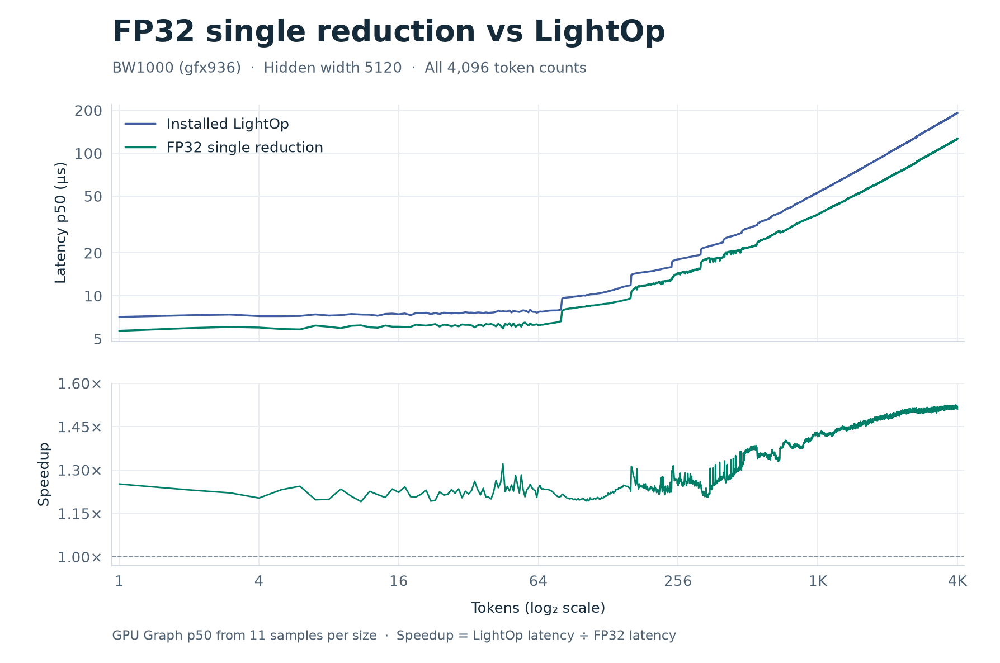

# 5120 维 Gemma Add + RMSNorm + Per-token INT8

适用于 gfx936。每个 CTA 处理一个 token。输入、残差和 Gemma 原始权重为 BF16，残差原地写回，返回 INT8 和每行 FP32 scale。

对每一列用 FP32 计算 $s_i=x_i+r_i$ 和 $p_i=s_i(1+w_i)$。同一轮 CTA 规约同时求出平方和 $S$ 与带权绝对最大值 $M$。

$$
S=\sum_{i=1}^{5120}s_i^2,\qquad M=\max_{1\le i\le 5120}|p_i|
$$

用 $S$ 求平方根倒数 $t$，再用 $M$ 算出每行的 scale $\sigma$。

$$
t=\frac{1}{\sqrt{S/5120+\epsilon}},\qquad
\sigma=\frac{\max(t\cdot M,10^{-10})}{127}
$$

将 $p_i\cdot t/\sigma$ 按最近偶数舍入到 INT8。归一化与量化之间保留 FP32 中间值，Qwen3.8-27B-int8 的双核路径在这里使用 BF16。在合成 BF16 输入和四层真实权重的对比中，两版的 INT8 码值有 7.24% 不同，反量化结果的相对 L2 差异为 0.78%–0.86%。

## 线程与读取调度

| Token 数 | 线程 / CTA | 每线程读取 | 调度 |
| --- | ---: | --- | --- |
| 1–63 | 640 | 8 列 | 编译器调度 |
| 64–159 | 512 | 8 列，前 128 线程再读 8 列 | 编译器调度 |
| 160–351 | 320 | 8+8 列 | 编译器调度 |
| 352–703 | 320 | 8+8 列 | 两组提前发射，分批等待，`glc slc` |
| 704–1407 | 512 | 8 列，前 128 线程再读 8 列 | 编译器调度 |
| 1408 及以上 | 320 | 8+8 列 | 两组提前发射，分批等待，默认缓存配置 |

320 线程的分批读取先发射两组向量 load，用 `vmcnt(3)` 等第一组。第一组的加法、平方和及带权绝对最大值计算完成后，再用 `vmcnt(0)` 等第二组。最后用一次 CTA barrier 汇总两组的 wave 部分结果。

## 构建与调用

在 gfx936 机器上加载 DTK 环境，从仓库根目录构建。Python 入口使用 HCU 版 PyTorch。

```bash
make -C fusion_gfx936/gemma_add_rmsnorm_per_token_int8_quant
python3 -m pytest -q fusion_gfx936/gemma_add_rmsnorm_per_token_int8_quant/test_gemma_int8_5120.py
```

```python
from fusion_gfx936.gemma_add_rmsnorm_per_token_int8_quant.python_api import gemma_fused_add_rmsnorm_int8_fp32

q, scale = gemma_fused_add_rmsnorm_int8_fp32(x, residual, weight, epsilon=1e-6)
```

`x` 和 `residual` 为 `[tokens, 5120]`，`weight` 为 `[5120]`。三个 BF16 张量需要在同一张卡上连续存放并按 16 字节对齐，残差与另外两个张量的存储区域需要互不重叠。算子在当前 PyTorch stream 上异步执行，返回的 `q` 和 `scale` 分别为 `[tokens, 5120]` 和 `[tokens, 1]`。

## 1–4096 token 性能对比

基线是已安装 LightOp `0.6.0+dtk2610.torch2110.2611031134.g6aa6bf` 的 `rms_norm_dynamic_per_token_quant_sglang`。两版在同一张 BW1000（gfx936）上使用相同的 5120 维 BF16 输入和残差、Qwen 第 0 层 `post_attention_layernorm` 权重与 `eps=1e-6`。LightOp 接收预先计算的 BF16 `1 + weight`，FP32 版接收原始权重。两版都输出 INT8 和 FP32 scale，并原地写回 BF16 残差。

从 1 到 4096 的每个整数 token 数，两版各预热 2 次再交替测量 11 次。每个 GPU Graph 包含 2–64 次算子调用，GPU event 计时除以图内调用次数，再取 p50。计时前恢复残差并预分配输出。加速比为 LightOp p50 除以 FP32 p50。



本轮 4096 个点的加速比为 **1.19×–1.52×**，中位数 **1.49×**。代表点延迟单位为 µs。

| Token 数 | LightOp p50 | FP32 单规约 p50 | 加速比 |
| ---: | ---: | ---: | ---: |
| 1 | 7.12 | 5.68 | 1.25× |
| 256 | 18.02 | 14.46 | 1.25× |
| 512 | 29.74 | 21.88 | 1.36× |
| 1024 | 52.68 | 37.14 | 1.42× |
| 2048 | 99.20 | 66.56 | 1.49× |
| 4096 | **191.44** | **126.72** | **1.51×** |

[4096 个点的延迟和加速比 CSV](latency-vs-lightop.csv)

构建后，在仓库根目录选择 gfx936 设备并运行基准。省略 `--model` 时使用合成 BF16 权重。

```bash
python3 -m fusion_gfx936.gemma_add_rmsnorm_per_token_int8_quant.benchmark \
  --model /path/to/Qwen3.8-27B-Channel-INT8-w8a8 \
  --output fusion_gfx936/gemma_add_rmsnorm_per_token_int8_quant/build/latency-vs-lightop.csv
```

## 与原 FP32 实验版及 Qwen 双核的复测

在 BW1000 上用 DTK 26.10 nightly 1112 重建。用相同的 BF16 输入和 Qwen 第 0 层权重，在 13 个 token 数下核对了原 FP32 实验二进制和独立版。INT8、scale 和 BF16 残差全部逐位一致。

同卡 GPU Graph p50，单位为 µs。

| Token 数 | Qwen 实际双核 | 原 FP32 实验版 | 独立构建版 |
| ---: | ---: | ---: | ---: |
| 1 | 7.60 | 5.22 | 5.22 |
| 256 | 19.81 | 13.39 | 13.74 |
| 512 | 31.40 | 21.25 | 21.43 |
| 1024 | 55.91 | 36.24 | 36.14 |
| 4096 | 193.64 | 119.82 | 120.10 |
| 16384 | 743.84 | 470.80 | 471.76 |
