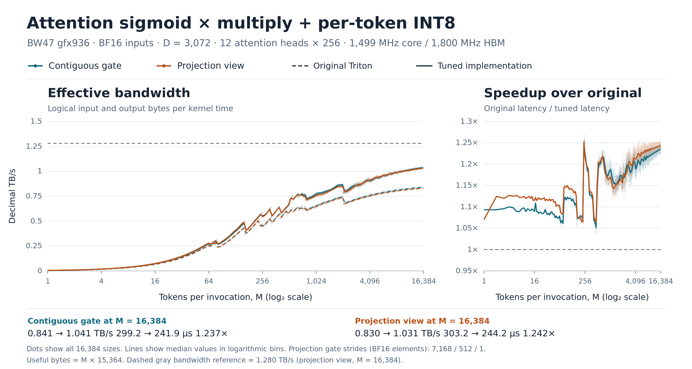

# Attention sigmoid × multiply + per-token INT8

This operator quantizes the gated attention output before `o_proj`. It computes the sigmoid and product in FP32, rounds the product to the input dtype, then computes one scale per token as `max(max(abs(row)), 1e-10) / 127`. The INT8 result uses round-to-nearest-even.

Pass contiguous BF16 or FP16 attention output of shape `[tokens, hidden]`. The gate may be `[tokens, hidden]` or a `[tokens, heads, head_dim]` view with unit last-dimension stride. The outputs are INT8 `[tokens, hidden]` and FP32 `[tokens, 1]`. The `fused_sigmoid_mul_per_token_quant` alias calls the same implementation.

## Using the two gate layouts

Run this example from the repository root on an HCU with HIP PyTorch and Triton. Both layouts use the same function. In a model, choose the call that matches the upstream tensor.

```python
import torch
from fusion_gfx936.sigmoid_mul_per_token_int8_quant import fuse_sigmoid_mul_int8_quant

M, heads, head_dim = 128, 12, 256
D = heads * head_dim
opts = dict(device="cuda", dtype=torch.bfloat16)
attention = torch.randn(M, D, **opts)

# Contiguous gate: all 3,072 gate values for each token sit next to each other.
gate = torch.randn_like(attention)
quantized, scales = fuse_sigmoid_mul_int8_quant(attention, gate)

# Projection view: use the output of the upstream QKV projection here.
qkv = torch.randn(M, 7168, **opts)
q_gate_pairs = qkv[:, :2 * D].view(M, heads, 2, head_dim)
gate_view = q_gate_pairs[:, :, 1, :]
assert gate_view.stride() == (7168, 512, 1)
quantized_proj, scales_proj = fuse_sigmoid_mul_int8_quant(attention, gate_view)
```

In this TP2 layout the first 6,144 elements in each QKV row alternate between a 256-value Q head and its 256 gate values. The slice selects the gate half of each pair and shares storage with the projection.

## gfx936 performance

The TP2 benchmark uses BF16, 12 heads of 256 elements and a per-rank width of 3,072. It compares a contiguous gate with the QKV projection view read directly from `[M, 7168]` at offset 256 and strides `(7168, 512, 1)` in BF16 elements. The baseline is the original fused Triton kernel at `5472b20`.

At width 3,072, one workgroup handles a token in three segments of 1,024. Its sigmoid uses a hardware exponential and a rescaled hardware reciprocal, then corrects the reciprocal in FP32 before the product. The quantizer adds a rounding bias to the scaled FP32 product and stores the low byte. The disassembly was checked for the exponential, reciprocal, correction and rounding instructions.



On the projection view, the geometric mean speedup across all 16,384 token counts was 1.219×. At M = 16,384, latency fell from 303.2 to 244.2 µs and effective bandwidth rose from 0.830 to 1.031 TB/s. The read/write-only control reached 1.280 TB/s on the same view. The gfx936 dispatch also covers BF16 widths 4,096 and 6,144 and FP16 widths 3,072 and 4,096.

The sweep covers every integer token count from 1 through 16,384 on BW47 with the core and HBM clocks held at 1,499 and 1,800 MHz. Each point is the median of five interleaved HIP Graph timings with preallocated outputs and pre-existing gate views. Effective bandwidth uses `M × (5 × 3072 + 4)` bytes per call for two BF16 inputs, the INT8 output and a per-token FP32 scale. The horizontal reference is a separately measured read/write-only kernel at M = 16,384. INT8 outputs and FP32 scale bits were checked against the original at every M in both layouts.

## Reproducing the comparison

Run from the repository root with HIP PyTorch and Triton. The existing reference tests also use LightOp's standalone quantizer.

```sh
python -m pytest -q fusion_gfx936/sigmoid_mul_per_token_int8_quant
python -m fusion_gfx936.sigmoid_mul_per_token_int8_quant.benchmark --hidden 3072 --dtype bfloat16 --tokens 1 160 512 4096 16384 --layout contiguous projection
```

The original BF16 implementation is also documented in [LightOp PR #182](https://github.com/HYGON-AI/lightop/pull/182).
