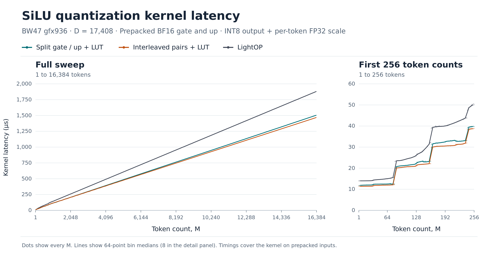
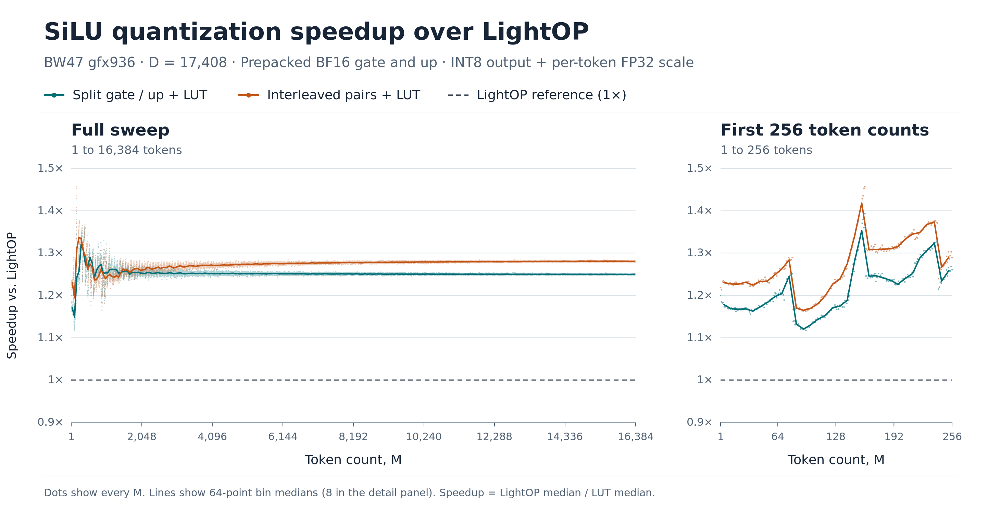

# gfx936 SiLU × up 与 per-token INT8 量化

一个 CTA 处理一个 token，在一次 kernel 调用中完成 SiLU 查表、乘法、行内绝对最大值规约与 INT8 量化。两个入口使用相同的 BF16 映射，区别在于上游写入 gate 和 up 的顺序。

| 入口 | 每个 token 的 BF16 输入 | 输出 |
| --- | --- | --- |
| `silu_mul_int8_split` | `[g0, g1, …, g(D−1), u0, u1, …, u(D−1)]` | 连续 INT8 `[M,D]` 和 FP32 scale `[M,1]` |
| `silu_mul_int8_interleaved` | `[g0, u0, g1, u1, …, g(D−1), u(D−1)]` | 同上，通道顺序相同 |

`D` 是单个 gate 或 up 分支的宽度，每行输入共 `2D` 个元素。支持 `D ∈ {5120, 8704, 17408}`。选择与上游输出布局匹配的入口即可。

## 查表与量化

用 gate 的 16 位 BF16 位模式直接索引 65,536 项的表。每个表项存储舍入到 BF16 的 `SiLU(gate)`，表大小为 128 KiB。内核用 `global_load_ushort` 读表，将结果扩展为 FP32，与对应的 up 相乘，再将乘积舍入到 BF16。

设舍入后的乘积为 `v`，每行计算 `amax = max(abs(v))`，写出 FP32 的 `scale = amax / 127`。量化时用 FP32 计算 `v × (127 / amax)`，按最近偶数舍入并限幅到 INT8。全零行输出全零，scale 为零。

## 构建与调用

在安装海光 DTK 的 gfx936 机器上，在本目录构建共享库，并用 HCU 版 PyTorch 检查两种布局是否一致。

```bash
bash build.sh build
python3 check.py --library build/libsilu_mul_int8.so
```

安装 LightOP 后可再检查参考输出。

```bash
python3 check.py --library build/libsilu_mul_int8.so --check-lightop
```

C 接口声明见 [silu_mul_int8.h](silu_mul_int8.h)。部署时把 `build/` 下的六个 `.so` 放在同一目录，调用方只需加载 `libsilu_mul_int8.so`。[构建脚本](build.sh) 将同一份 [HIP 源码](kernels.hip) 编译为五个独立设备代码对象，每个对象持有自己的 128 KiB 查表数据。每个设备调用一次 `silu_mul_int8_init(stream)` 即可初始化全部五张表。若多个流共用，使用 HIP event 让其它流等待初始化完成。

两个入口都异步写入调用方分配的连续设备缓冲区。输入、INT8 输出和 FP32 scale 的首地址分别按 16、8 和 4 字节对齐。[路由表](routes.inc) 根据 D 和 M 选择对应实现。

## D = 17408 的逐点性能

在 BW47 的 BW1000（gfx936）上，核心与 HBM 实测频率分别为 **1499 MHz 和 1800 MHz**。三个方案均使用同一批 BF16 输入，输入布局和输出缓冲区在计时前准备好。GPU event 只计量化算子，在 `M=1…16384` 的每个整数点各测 5 轮，取每次调用延迟的中位数。参考实现是 LightOP `fuse_silu_mul_quant`。

两种布局在 34 个代表性 M 上筛选线程数、每线程处理的通道数和同步方式，并在邻近 M 复核。原布局在全部 M 上每线程每次处理 8 个通道。交错布局大部分 M 每次处理 4 对 gate/up，可用一条 16 字节向量指令读入这 4 对。`M=859…991` 使用每次处理 8 对的实现。

### 延迟



### 相对 LightOP 的加速比

加速比为同一个 M 上的 LightOP 延迟除以对应布局的延迟。各个 M 等权，原布局的几何平均加速比为 **1.251×**，交错布局为 **1.274×**。交错布局在 16,384 个点中的 15,333 个点领先原布局。`M=513…2048` 时原布局平均快约 0.4%，`M=8193…16384` 时交错布局在每个点上都更快。



| M | LightOP 延迟（µs） | 原布局延迟（µs） | 交错布局延迟（µs） |
| ---: | ---: | ---: | ---: |
| 1 | 13.98 | 11.65 | 11.47 |
| 128 | 25.81 | 22.00 | 21.00 |
| 512 | 81.65 | 62.77 | 63.63 |
| 4096 | 491.20 | 391.52 | 386.08 |
| 16384 | 1879.36 | 1504.96 | 1468.80 |

所有 16,384 个 M 均已对照 LightOP，两个布局输出的 INT8 值和 FP32 scale 位模式逐点一致。从发布版共享库提取的五个 gfx936 设备代码对象（`.hsaco`）与基准使用的对象逐字节相同，包含指令、查表数据的链接布局和内核元数据。
