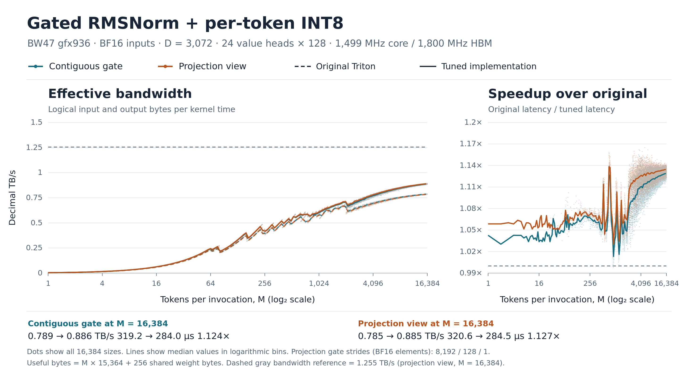

# GDN gated RMSNorm + per-token INT8

这个算子先对每个 128 维 value head 单独做 RMSNorm、乘共享权重，再乘以 FP32 的 SiLU gate。乘积舍入到 BF16 后，在同一 token 的全部本地 heads 上求绝对值最大值，得到一个 FP32 scale，再按最近偶数舍入输出 INT8。

`x` 的形状为 `[tokens * num_heads, 128]`。`z` 可以与 `x` 同形状，也可以是 `[tokens, num_heads, 128]` 的投影视图，最后一维连续。共享权重为 `[128]`。三者均为同卡 BF16。输出为 `[tokens, num_heads * 128]` 的 INT8 和 `[tokens, 1]` 的 FP32 scale。

## 使用两种 gate 布局

在装有 HIP PyTorch 和 Triton 的 HCU 上，从仓库根目录运行下面的示例。两种布局共用同一个函数，直接传入上游产生的 gate 即可。

```python
import torch
from gated_rms_norm_per_token_int8_quant import gated_rms_norm_per_token_int8_quant

M, heads, head_dim = 128, 24, 128
opts = dict(device="cuda", dtype=torch.bfloat16)
x = torch.randn(M * heads, head_dim, **opts)
weight = torch.ones(head_dim, **opts)

# 连续 gate，每个 token 的 24 个 head 紧密排列。
z = torch.randn(M, heads, head_dim, **opts)
q, scale = gated_rms_norm_per_token_int8_quant(x, z, weight, 1e-6, num_heads=heads)

# 投影视图。实际使用时 projection 直接取上游投影层的输出。
projection = torch.randn(M, 8192, **opts)
z_view = projection[:, 5120:].view(M, heads, head_dim)
assert z_view.stride() == (8192, 128, 1)
q_proj, scale_proj = gated_rms_norm_per_token_int8_quant(x, z_view, weight, 1e-6, num_heads=heads)
```

切片和 `view` 共享上游投影的显存。这里的两次调用分别演示一种布局，在模型中按实际输入选一次即可。

## gfx936 定频对比

TP2 每个 rank 有 24 个 value head，合计 3,072 维。连续 gate 把每个 token 的 3,072 个元素首尾相接。投影视图直接从 `[M, 8192]` 每行偏移 5,120 的位置开始读，步长为 `(8192, 128, 1)`。同一个 token 的 24 个 gate head 彼此连续，读取下一个 token 时才跨过投影中的其他字段。

每个工作组处理一个 token，分三组、每组 8 个 head。优化版保留原实现的每个 head 求和顺序。在 24-head 路径上，表就绪时，小批量用 BF16 位模式索引 65,536 项 FP32 SiLU 值（256 KiB）。超过 2,048 个 token 时直接计算带 FP32 修正的倒数。首次调用或冷启动 Graph 捕获时也可以直接计算。表就绪后可跨 stream 复用。量化使用带修正的倒数和最近偶数舍入。



在投影视图上，16,384 个 M 的几何平均加速比为 1.121×。M = 16,384 时，延迟从 320.6 降到 284.5 µs，有效带宽从 0.785 提升到 0.885 TB/s。同布局的纯读写为 1.255 TB/s。两种布局、全部 M 的 INT8 输出和 FP32 scale 均与原版逐位一致。

基线为仓库 `5472b20` 的原始融合 Triton 实现。BW47 核心和 HBM 频率分别为 1,499 和 1,800 MHz。在两种布局上对每个整数 `M=1…16384` 分别计时，取五轮交错 HIP Graph 重放的中位数。输入视图、输出和小批量查表均预先准备。有效带宽按每次调用 `M × (5 × 3072 + 4) + 256` 字节计算，含两份 BF16 输入、INT8 输出、逐 token scale 和一份共享权重。纯读写参照在 `M=16384` 单独测量。

## 复测

在有 HIP PyTorch 和 Triton 的环境里，从仓库根目录运行。

```sh
python -m pytest -q gated_rms_norm_per_token_int8_quant
python -m gated_rms_norm_per_token_int8_quant.benchmark --tokens 1 64 512 2048 4096 16384 --layout contiguous projection
```

原实现的开发背景见 [LightOp PR #181](https://github.com/HYGON-AI/lightop/pull/181)。
