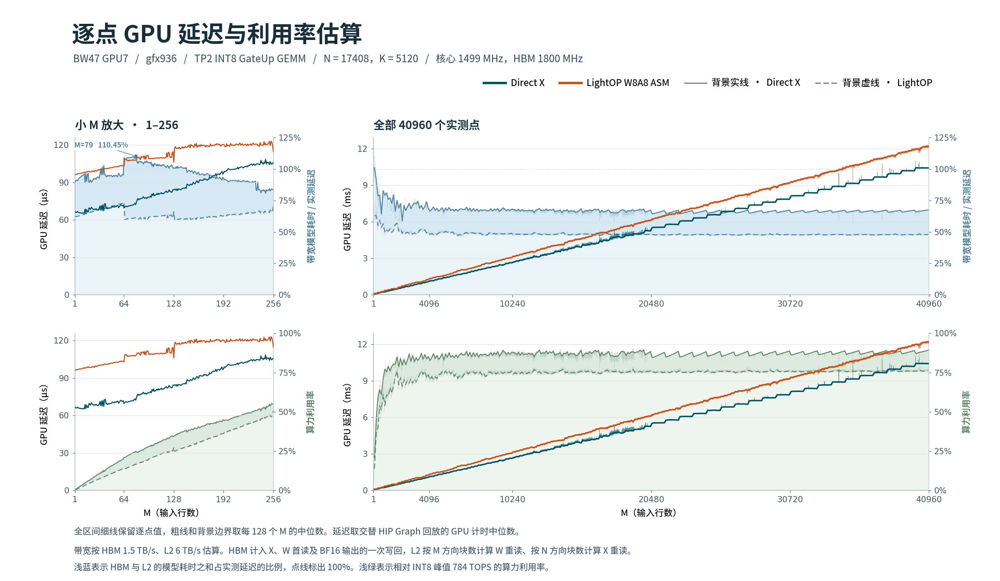
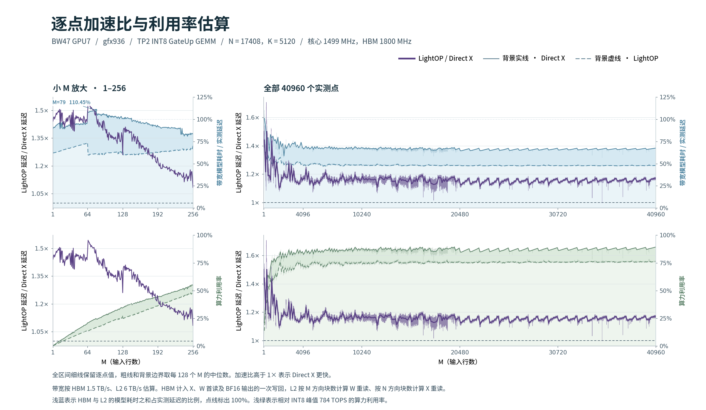
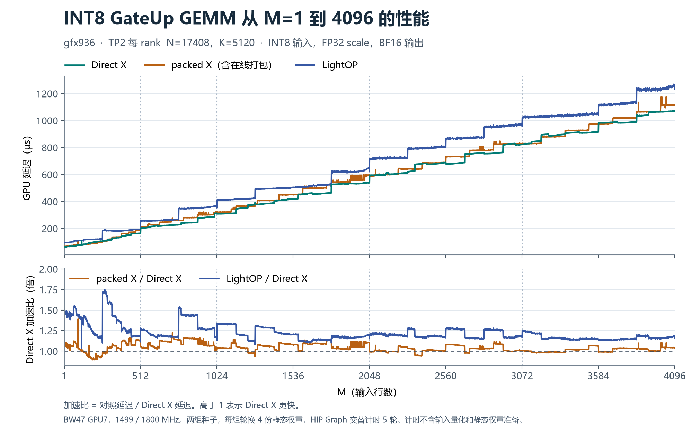

# gfx936 非融合 GateUp GEMM

输入 K=5120。TP1 的 N=34816，TP2 每 rank 的 N=17408。BF16 和 packed X INT8 支持 M=1–4096，TP2 的 Direct X INT8 支持 M=1–40960。所有入口按输入权重的列顺序写出 BF16 `Y[M,N]`。

## BF16 单份 W[K,N]

`BF16GateUpGemm` 直接持有调用方传入的连续 BF16 `W[5120,N]`。如果 checkpoint 保存为 `W[N,5120]`，加载时转置一次即可。

M=1–256 使用实测选择的 GEMV、rolling MMAC、`torch.mm` 或 rocBLAS。M=257–4096 使用同一份 W 的 `torch.mm` 或 rocBLAS。TP2 默认路径按 M 选择是否转置 X、沿 N 分段，以及是否将 X 的 pitch 和计算行数补齐到 16、32、64 或 128 的倍数。补齐路径只返回前 M 行。显式传入 `out[M,N]` 时只用物理输出恰好为 M 行的路由。

从仓库根目录构建。所需环境为 gfx936 BW1000、DTK 和 HCU 版 PyTorch / Triton。

```bash
source /opt/dtk/env.sh
python -m gemm_gfx936.gate_up_gemm_gfx936.build_bf16
```

```python
from gemm_gfx936.gate_up_gemm_gfx936.bf16 import BF16GateUpGemm

op = BF16GateUpGemm(weight_kn)
y = op(x)
```

使用预分配缓冲区时，`workspace_elements(M, exact=True)` 返回精确 `[M,N]` 输出路径的 X 工作区元素数。用 `output_rows(M)` 查询默认路径的物理输出行数。

推理时可以在目标 stream 预热后捕获 HIP Graph。所有工作完成并释放 Graph 后，用 `op.close()` 释放该实例的 rocBLAS handle。

`bf16-policy.json` 中，`default` 和 `exact` 记录一段连续 M 的上界。精确输出在 M≤256 使用 `exact`，之后以 `default` 为基础。`tail` 记录默认路径的尾块对齐。TP2 的 `overrides` 按闭区间 `[first, last, route]` 覆盖默认路径。精确输出可以复用其中物理输出为 M 行、且 X 工作区需求不增加的路由。 `exact_overrides` 另外记录单独用 `out[M,N]` 实测的路由。rolling 汇编复用仓库中的 LM head 生成器。

在 BW47 GPU2 上重建后，8 个 rolling HSACO 与实验版逐字节一致。TP1/TP2 的全量路由和缓冲区尺寸一致，184 组实跑输出逐元素一致。各 TP 的 Graph 时延中位数变化均在 0.02% 内。

BW47 尾块实验在 TP1 和 TP2 各逐点复测 M=1–2048。TP1 保留 332 个补齐点，TP2 保留 114 个。M=257–2048 的 Graph 平均时延分别从 1.262 降至 1.212 ms、从 0.643 降至 0.638 ms。计时包含在线 X 转置和 BF16 写回。

BW46 定频复测中，TP2 使用 Qwen3.8-27B 第 0 层权重和随机输入。相对 ce256fe，默认路径修改的 637 个 M 的几何平均加速为 1.078×，4096 个 M 的等权平均延迟从 1062.5 降到 1051.6 µs。预分配精确输出的 198 个变更点几何平均加速为 1.201×。按 M 预分配默认工作区的调用方应查询 `workspace_elements(M)`，覆盖所有 M 的最大容量仍为 40 MiB。计时包含在线 X 处理和 BF16 写回。

## INT8 单份 packed W

`Int8GateUpGemm` 用一份 packed INT8 W 和 FP32 `scale_w[N,1]`。每次调用接受连续 INT8 `X[M,5120]` 和 FP32 `scale_x[M,1]`。固定寄存器汇编完成 INT32 累加，乘以两份 scale 后写回 BF16 `Y[M,N]`。

`pack_int8_weight` 在权重加载时把连续 `W[N,5120]` 转成不透明的一维存储。布局按 K64 分段，每段按 16 行一组重新排列。初始化算子后即可释放原始 INT8 W。

```bash
source /opt/dtk/env.sh
python -m gemm_gfx936.gate_up_gemm_gfx936.build_int8
```

```python
from gemm_gfx936.gate_up_gemm_gfx936.int8 import Int8GateUpGemm, pack_int8_weight

packed_w = pack_int8_weight(weight_nk)
op = Int8GateUpGemm(packed_w, scale_w)
y = op(x, scale_x)
```

可以传入精确形状的 `out[M,N]` 和工作区。`workspace_elements(M)` 返回当前路由所需的 INT8 元素数，包含补齐和已选路由的 X pitch 偏移。权重准备、X 打包和 GEMM 会提交到调用方当前 stream。跨 stream 交接权重或复用工作区时，由调用方同步。

TP2 的 main 路由在 M≥257 时以 16×256 分块打包 X；合入的调优路由使用连续遍历打包输出的一维 kernel，并保留各自实测的 X pitch。两种打包方式生成相同的 K64 片段格式。main 中沿 M 方向遍历、每块 256 列的 TP2 内核用普通 `global_store_dwordx2` 写回 BF16；调优内核保留其原有的写回指令。

`int8-policy.json` 记录 M=1–4096 的 packed 路由。TP2 按整次 GPU 调用耗时合并 main 和调优版，计时包含在线 X 打包、GEMM、缩放及 BF16 写回，不含离线 W 准备。TP1 的路由保持原样。汇编构建使用 PyYAML 并复用 `fused_gate_up_gemm_gfx936` 的公共装载、MMAC 和同步宏。

在 BW47 GPU2 上重建后，50 个 INT8 HSACO 与实验版逐字节一致。TP1/TP2 的全量路由和 X 工作区尺寸一致，168 组实跑输出逐元素一致。各 TP 的 Graph 时延中位数变化均在 0.02% 内。TP1 的 M=4095 首轮慢 4.4%，6 次交替重捕获的时延比中位数为 +0.76%。

BW46 定频复测使用 Qwen3.8-27B 第 0 层 BF16 权重，离线逐输出通道量化为 INT8。每个 M 使用随机 INT8 输入和逐 token FP32 scale。相对 ce256fe，4096 个 M 的等权平均延迟从 601.5 降到 584.0 µs，M=257–4096 的几何平均加速为 1.027×。M=4096 从 1175.5 降到 1117.7 µs。计时包含在线 X 打包、GEMM、缩放和 BF16 写回。

### packed X 调优版合并

TP2 在两次独立的 M=1–4096 扫描中选择稳定受益的整次调用：一轮至少快 2%，另一轮同样快于 main；其余位置保留 main 路由。合入的内核包括 M=65–128 的 E047、部分 M=193–224 的拆分预取、8-wave 的 144×256 / 192×256 tile，以及 256×128 的 MMAC 分组和成对 FP32 缩放。

`kernels/int8_tuned.json` 保存这些内核的生成参数、wave 数和打包方式。固定寄存器内核由 `packed_asm.py` 生成；E047 的两个入口保存在 `kernels/e047_bf16.s`，保留编译器分配的寄存器和原有执行顺序。构建过程不依赖历史实验目录或预编译二进制，公开调用方式与 W 格式不变。工作区大小仍应通过 `workspace_elements(M)` 查询。

BW47 GPU3、核心 1499 MHz / 显存 1800 MHz 定频复测，以 2bb232a 为基线。每个 M 轮换 4 份独立随机 INT8 W，使用 HIP Graph 做 5 轮交替计时。合并版逐点通过 M=1–4096 的逐元素正确性及输出边界校验，另通过 31 个 one-hot 形状。53 个重建内核的函数机器码均与对应的 main 或调优原版逐字节一致。

200 个变更点的整次调用几何平均加速为 1.074×，纯 GEMM 为 1.087×；全部 4096 个 M 的整次调用为 1.0035×。其余 3896 个点保留原路由和工作区大小，整次调用时延比的几何平均变化小于 0.01%。以下是同轮全量扫描的整次调用中位数，单位 µs：

| M | main | 合并版 |
|---:|---:|---:|
| 128 | 88.72 | 80.48 |
| 208 | 94.24 | 88.56 |
| 224 | 94.60 | 90.84 |
| 384 | 149.40 | 137.44 |
| 512 | 191.68 | 183.60 |

另在全部 200 个变更点和 22 个边界点用 3 个独立随机种子、每种子 7 轮交替复测。变更点整次调用几何平均加速为 1.073×，全部仍快于 main；合并版相对原调优版的整次调用时延比为 1.0009，重建未改变其性能。TP1 全部 4096 个 M 的路由及工作区尺寸保持一致，覆盖 19 个内核的 38 个实跑形状逐元素正确。

### Direct X（TP2，M=1–40960）

`DirectXInt8GateUpGemm` 是独立入口，支持 TP2 的 N=17408、K=5120、M=1–40960。输入是连续、16 字节对齐的 INT8 `X[M,5120]` 和 FP32 `scale_x[M,1]`，输出 BF16 `Y[M,17408]`。每次调用只提交一个 GEMM kernel，`workspace_elements(M)` 为 0，无需补齐或单独打包 X。支持区间外的 M 会报错。

构建不需要先生成 packed-X 代码对象。结果写入独立的 `build/int8_direct`，不修改 `build/int8`：

```bash
source /opt/dtk/env.sh
python -m gemm_gfx936.gate_up_gemm_gfx936.build_int8_direct
```

```python
from gemm_gfx936.gate_up_gemm_gfx936.int8 import pack_int8_weight
from gemm_gfx936.gate_up_gemm_gfx936.int8_direct import DirectXInt8GateUpGemm

packed_w = pack_int8_weight(weight_nk)
direct = DirectXInt8GateUpGemm(packed_w, scale_w)
y = direct(x, scale_x)
```

packed W 格式与 `Int8GateUpGemm` 完全相同。若同时使用两种入口，可以将同一个 `packed_w` 传给两个实例，共享权重存储。原 `Int8GateUpGemm`、`int8-policy.json` 及其 M=1–4096 分发保持原样。可以传入精确形状的 `out[M,N]`；输出存储必须与输入分离。两种入口都使用调用方当前 stream，跨 stream 交接由调用方同步。

`int8-direct-policy.json` 独立保存逐 M 路由及内核的生成参数，不读取 packed-X 路由表或历史实验二进制。调用时按 M 查表选择内核，选项包括 tile 尺寸、读取方式、拆分预取和 MMAC 分组。沿 N 分工时，coalesced 方式让相邻四个 lane 读取同一行的 K64 片段，并通过 LDS 读地址的逆映射恢复 MMAC 操作数。部分内核复用地址寄存器，或在同一个 GEMM 内通过寄存器预取 X、在原有同步点写入 LDS。

这里“纯 GEMM＝整次”指预分配输出时的 GPU 执行时间，不包含输入量化、静态 W 准备或 CPU 调用开销。M 接近 128 时 direct 与 packed 整次调用接近，独立入口便于调用方按实际形状选择；默认入口仍为 packed-X 方案。

#### M=4096–40960 的分组调度

M 较大时使用 BM128×BN512、8-wave 内核。按 M 查表得到 `group_width(M)`，单位是 128 行的 M tile。宽度为 0 时使用原始二维网格。宽度为 G 时，三维网格先在一组 G 个 M tile 内覆盖 N 方向的全部 34 个 tile，然后进入下一组。末组中越界的 CTA 在首次访问输入、输出或工作组屏障之前退出。两种调度均只提交一次 GEMM，每个有效输出 tile 完成全部 K=5120 的点积和缩放。升级已有构建时运行上面的 `build_int8_direct` 命令生成分组内核。

4096–20480 的全部 16385 个整数 M 都在 BW47 GPU7 上实测了 3–4 种选择，包括原始网格、先前按 M tile 数选择的组宽，以及相邻对齐形状上的候选，共 51459 个候选与形状组合。每个 M 轮换两份权重、交错测量 4 轮。对初筛中准备更换组宽的 2507 个 M，换新输入和权重复测 6 轮，最终保留 1247 个变更。在调优数据上，冻结策略相对原始网格的逐 M 几何平均加速为 1.142×，相对先前按 M tile 数分组的策略为 1.0013×。

20481–40960 使用 40 个 M tile 一组。M=40960 时，每组覆盖 5120 行，共 8 组，输出为 1360 MiB 的 BF16 矩阵。

有效 INT8 吞吐按每个 TP2 rank 的 GEMM 工作量计算。一次乘加计两次运算，`TOPS = 2*M*N*K / (time_us*1e6)`。时延包含缩放和 BF16 写回，分子只计矩阵乘加。

#### M=1–40960 的 Direct X 与 LightOP 实测

在 BW47 GPU7 上冻结上述策略，换一组输入和权重，逐点比较公开入口与 LightOP 0.6.0 的 gfx936 W8A8 ASM。两条路径共用已量化的 X、两份轮换的随机权重和 scale。LightOP 在 M≤64 使用 SGLang HCU 插件对应的 slide=9，其余 M 使用库的 ASM 配置。每个 M 交替回放 HIP Graph 三轮，每轮时间除以两份权重，再取中位数。4537 次硬件采样的核心/HBM 频率均为 1499/1800 MHz。40960 个形状、两条路径和两份权重的 163840 份完整 BF16 输出均与独立 INT32 参考按相同缩放规则得到的结果逐位相同。

| M | 点数 | Direct X 更快的点数 | LightOP 延迟 / Direct X 延迟的几何平均 |
|---|---:|---:|---:|
| 1–4095 | 4095 | 4095 | 1.211× |
| 4096–20480 | 16385 | 16385 | 1.159× |
| 20481–40960 | 20480 | 20479 | 1.151× |
| 1–40960 | 40960 | 40959 | 1.160× |

M=20480 的 Direct X / LightOP 延迟为 5.258 / 6.148 ms，M=40960 为 10.424 / 12.245 ms。M=40960 时 Direct X 的单 rank 有效吞吐为 700.44 TOPS。





两图左侧放大 M=1–256，右侧覆盖全部 40960 点。右侧的细线保留逐点值，粗线取每 128 个连续 M 的中位数。背景读右轴，实线对应 Direct X，虚线对应 LightOP。

带宽模型以字节计。INT8 输入 `X=M*K`、`W=N*K`，BF16 输出 `Y=2*M*N`。令 `BM=ceil(M/tile_m)`、`BN=ceil(N/tile_n)`，每种实现使用该 M 实际调度的 tile。HBM 计入 X、W 各一次首读和 Y 一次写回，L2 计入 W 在 M 方向、X 在 N 方向的重读。模型仅计这三个矩阵。下式使用十进制 TB/s，实测延迟 `t` 以秒计。

```text
T_bw = (X + W + Y) / 1.5e12 + ((BM - 1)*W + (BN - 1)*X) / 6e12
带宽模型占比 = T_bw / t
INT8 算力利用率 = 2*M*N*K / (784e12*t)
```

M=40960 时，Direct X 与 LightOP 的带宽模型占比分别为 67.56% 和 47.80%，算力利用率分别为 89.34% 和 76.06%。Direct X 的带宽模型峰值在 M=79。此时模型中 HBM 和 L2 分别耗时 61.52 µs 和 18.27 µs，两项相加再除以实测的 72.24 µs 得到 110.45%。这个比值衡量模型耗时与实测的关系，物理带宽占用需由硬件计数器测量。

[逐点数据（CSV.gz）](results/direct-x-lightop-40k/per-m.csv.gz) 含每个 M 的两条实测延迟（µs）和两种实现各自的 tile 行列数。在数据目录中运行 `python plot.py` 可重算上述指标，并将英文标注的两张图写入 `redrawn/`。[绘图脚本](results/direct-x-lightop-40k/plot.py) 依赖 NumPy 和 Matplotlib。

#### M=4097–20480 的原始网格基线（77c5b8c）

此版本沿用 M=4096 的 BM128×BN512、8-wave 内核，每个 CTA 计算 128 行、512 列。末块按实际行数读 X 和写 Y。M=20480 时沿 M 启动 160 个 CTA，沿 N 启动 34 个 CTA，单次 launch 写出 680 MiB 的 BF16 结果。

在 BW47 GPU7（gfx936）固定核心和 HBM 档位为 1500/1800 MHz，第二次计时期间的 40 次硬件采样均为 1499/1800 MHz。在 14 个 M 上比较 7 个候选内核，两次测试分别生成一份随机 INT8 权重和输入。每个候选使用同一组数据和预分配输出，每轮随机打乱候选顺序。下表为 HIP Graph 的 GPU 时间，每轮取 3 次回放的平均值，再取 7 轮中位数。合并两次共 14 轮计时取中位数后，选用的内核在 10 个采样点最快，其余采样点与对应最快候选相差最多 1.39%。

| 随机种子 | M=4097 | M=8192 | M=16384 | M=20480 |
|---|---:|---:|---:|---:|
| 20261125（µs） | 1140.05 | 2471.41 | 4944.96 | 6147.99 |
| 20261126（µs） | 1134.67 | 2380.48 | 4783.41 | 5871.99 |

正确性验证覆盖新增的全部 16384 个整数 M。每个 M 使用公开入口计算完整输出，与独立 INT32 GEMM 按相同缩放顺序生成的 BF16 参考逐位比较，并检查输出两侧各 1024 个 16 位哨兵和零工作区。另用 one-hot 输入覆盖 BM128 的全部尾块余数，并在 M=4097、8193、20479、20480 验证独立 stream 上的 HIP Graph 回放。

#### M=513–4096 的 Direct X 路由

新增区间覆盖全部 3,584 个整数 M。按实测结果将它们合并为 42 段，共用 15 个内核，其中 1 个与 M≤512 共用。原有 512 个路由和 73 个代码对象均与上一版一致。完整构建生成 87 个 HSACO，各自的 SHA256 与参与测试的版本一致。

M=4096 选择沿 N 分工的 BM128×BN512、8-wave 内核。一个 CTA 负责一个 128×512 输出块。每个 wave 用 4 个分片槽轮换读取 LDS 中的 8 个 X 分片，每个槽占用 4 个 VGPR。上一个分片的最后一条 MMAC 发射后，该槽即可读入新分片。固定 tile、CTA 顺序、预取点、MMAC 分组和写回方式，在 BW47 GPU7 上比较不同窗口，M=4096 的 8/4/2 分片窗口分别为 1362.56/1070.18/1095.30 µs，对应 204/188/180 个 VGPR。此项独立对照使用 8 份权重、7 轮交替测量，窗口大小同时改变 LDS 读指令的发射位置、等待值和寄存器占用。

在 BW47 GPU7 上固定核心 1499 MHz、显存 1800 MHz，以两个独立种子逐点测试全部 4096 个 M。每个种子轮换 4 份权重，四条路径随机交错回放 HIP Graph 5 轮，取每轮的单次 GPU 时延，再按轮和种子取中位数。packed X 包含每次调用时的 X 打包，各路径均从已量化的 X 和准备好的 W 开始。LightOP 使用容器内的 gfx936 W8A8 汇编 GEMM。M≤512 的旧 Direct X 是上一版公开入口，M≥513 的旧 Direct X 是此前覆盖到 M=4096 的实验路由。

| M | 旧 Direct X / 新 Direct X | packed X / 新 Direct X | LightOP / 新 Direct X | 新 Direct X 快于 packed X 的点数 |
|---|---:|---:|---:|---:|
| 1–512 | 1.003× | 1.030× | 1.351× | 350/512 |
| 513–1024 | 1.178× | 1.098× | 1.270× | 512/512 |
| 1025–2048 | 1.156× | 1.058× | 1.201× | 971/1,024 |
| 2049–3072 | 1.261× | 1.022× | 1.204× | 777/1,024 |
| 3073–4096 | 1.424× | 1.014× | 1.161× | 668/1,024 |
| 513–4096 | 1.261× | 1.040× | 1.200× | 2,928/3,584 |

表内加速比是逐 M 比值的几何平均。M=4096 时，新 Direct X / 旧 Direct X / packed X / LightOP 分别为 1069.38 / 1484.36 / 1112.82 / 1233.24 µs。另取 10 个 M，以相同的两个种子各轮换 32 份权重、交错回放 7 轮，该口径下 M=4096 分别为 1075.75 / 1488.47 / 1116.27 / 1253.91 µs。

对全部 4096 个 M，随机输入和 one-hot 输入的 BF16 结果均与独立 INT32 参考逐位相同，紧凑输入与输出边界哨兵检查通过。另在 22 个边界及代表点验证了独立 stream 上的 HIP Graph 回放。

#### 此前 M=1–512 版本的定频验证

BW47 GPU7（gfx936）在核心 1499 MHz、显存 1800 MHz 下逐点比较三个入口。M≤128 的旧 Direct X 取自 `90ab436`，M=129–256 使用此前独立调优的实验路由，M=257–512 使用此前 M=1–4096 实验的对应路由。packed X 使用 `90ab436` 的 `Int8GateUpGemm`，计时包含在线打包。三条路径共用 X、权重及 scale，预分配输出，用 HIP Graph 测 GPU 时间。每个 M 使用两个独立种子，每种子轮换 32 份随机 W，交替计时 7 轮。下表用每个种子的中位数汇总各 M，再对逐点加速比取几何平均。

| M | 旧 Direct X / 新 Direct X | packed 整次 / 新 Direct X | 新 Direct X 快于 packed 的点数 |
|---|---:|---:|---:|
| 1–128 | 1.0014× | 1.0585× | 124/128 |
| 129–256 | 1.0012× | 0.9389× | 0/128 |
| 257–384 | 1.0535× | 1.0320× | 96/128 |
| 385–512 | 1.2229× | 1.1098× | 128/128 |
| 1–512 | 1.0661× | 1.0329× | 348/512 |

M=512 使用 8-wave、BM128×BN512 的 N-split 内核。每个 K 阶段保留 4 个共享 X 分片的寄存器槽，最后一条消费旧分片的 MMAC 发射后，再把下一个 LDS 分片读入该槽，并按已发射读请求数更新 `lgkmcnt` 等待值。相同 tile、权重和 CTA 顺序下，8 分片与 4 分片的独立对照分别为 188.76 和 162.80 µs，声明的 VGPR 从 204 减到 188。最终公开入口的两个种子汇总值为 162.72 µs，旧 Direct X 为 237.81 µs，packed X 整次为 184.58 µs。

选定的 M=1、2、3、6、289、305 使用 K 循环入口填充。首次进入循环执行填充指令，循环回跳直接跳到其后的标签。M=361–380 在公共入口复测后采用旧实验路由。M=129–256 的 128 个形状均由 packed X 整次调用取得更低延迟。

从公开构建入口生成的 73 个 HSACO 的 SHA256 均与实测候选一致。M=1–512 全部通过紧凑随机 X 和逐行 one-hot X 的 BF16 位级对比、输出前后哨兵检查及零工作区检查。15 个代表形状通过非默认 stream 上的 HIP Graph 回放验证。

#### M=1–128 首版（90ab436）

在 BW47 GPU7 独占、核心1499 MHz / 显存1800 MHz 下验证：33 个 direct 代码对象与保存的实验方案逐字节一致，M=1–128 的随机输入、紧凑 X one-hot、输出边界、Graph 及非默认 stream 校验通过。重新构建 direct 前后，packed 构建目录内 157 个文件的哈希和修改时间均不变，其 53 个内核与 12bf4c2 一致。

逐点使用 3 个独立种子、每种子 7 轮交替计时，每轮轮换 32 份独立 W。仓库入口相对实验入口的时延比几何平均为 0.99998，最慢点为 +0.31%；相对当前 packed 整次调用，M=1–128 的几何平均加速为 1.057×。同轮结果如下，单位 µs：

| M | Direct X（纯＝整次） | packed X 整次 |
|---:|---:|---:|
| 1 | 66.08 | 68.70 |
| 32 | 65.07 | 69.41 |
| 64 | 66.71 | 72.83 |
| 65 | 67.63 | 75.70 |
| 96 | 74.79 | 77.24 |
| 112 | 77.01 | 78.61 |
| 128 | 79.27 | 79.85 |

### Direct X、packed X 与 LightOP 性能对比（M=1–4096）

图中 Direct X 使用覆盖 M=1–4096 的扩展版。在 BW47 GPU7 上逐点测试 TP2 的每个整数 M，每个 rank 的 N=17408、K=5120。上图为 GPU 延迟，下图为对照延迟除以 Direct X 延迟，高于 1 表示 Direct X 更快。packed X 的计时包含在线打包 X。


